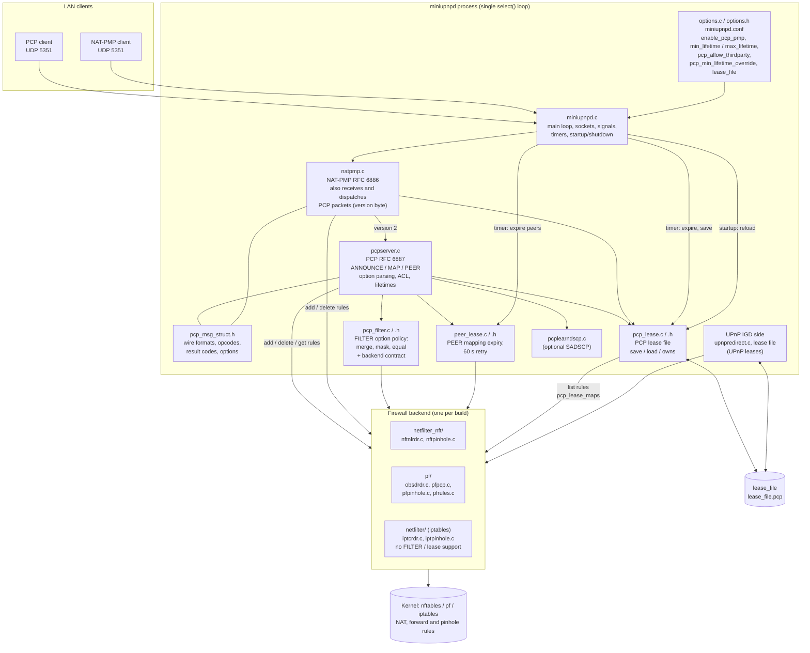
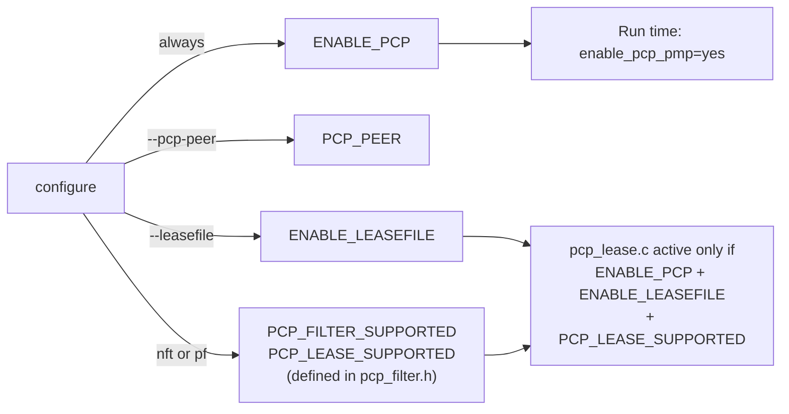
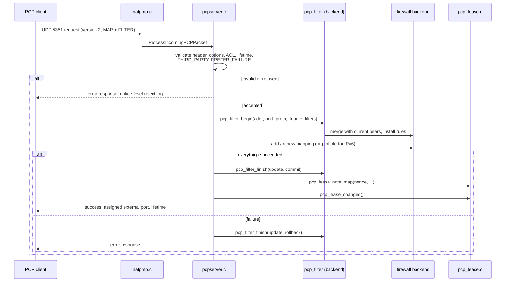
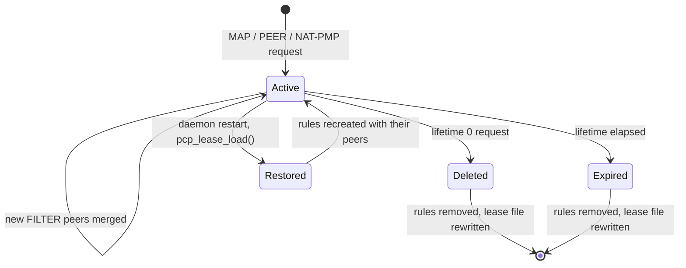
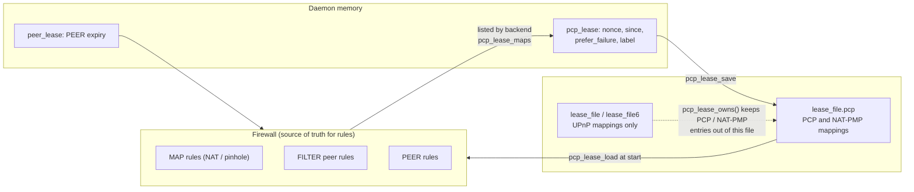

# PCP / NAT-PMP in miniupnpd: high-level design

Scope: the `enable_pcp_pmp` part of miniupnpd (NAT-PMP and PCP), as on branch `feat/pcp-peer-filter`.

## 1. Standards

| Standard | Status in the code |
|---|---|
| RFC 6886 NAT-PMP | Implemented (`natpmp.c`): external address, UDP/TCP mapping, public address change notification. |
| RFC 6887 PCP (version 2) | Implemented (`pcpserver.c`): ANNOUNCE, MAP, PEER (needs `--pcp-peer`), THIRD_PARTY, PREFER_FAILURE and FILTER options, epoch time, unsolicited ANNOUNCE on multicast 224.0.0.1 / ff02::1 port 5350. Both IPv4 NAT mappings and IPv6 firewall pinholes (a pinhole cannot translate the internal port). |
| PCP version 1 (draft) | MAP/PEER v1 message sizes are parsed (`PCP_MAP_V1_SIZE`, `PCP_PEER_V1_SIZE`). |
| RFC 7220 (DESCRIPTION option) | Implemented for MAP and PEER (`pcpserver.c`). The text must be UTF-8 without NUL; up to 128 bytes are kept (cut on a character boundary) and sent back in the response. Invalid text is ignored and left out of the response. A renewal with the option replaces the text, an empty option clears it, a renewal without it keeps it. More than one DESCRIPTION, or more than 1016 octets, is MALFORMED_OPTION. The text is the `label` column of the PCP lease file; it is not put in the firewall rule description. |
| RFC 7652 (authentication) | Option codes are reserved in `pcp_msg_struct.h`. Not implemented. |
| `SADSCP` opcode, `FLOWP` option | Compile-time options (`PCP_SADSCP`, `PCP_FLOWP`), off by default. Use `pcplearndscp.c`. |

## 2. Subsystems and files



### File roles

| File | Role |
|---|---|
| `miniupnpd.c` | `select()` loop. Opens the NAT-PMP/PCP sockets (IPv4 per listening address, one IPv6), calls `ProcessIncomingNATPMPPacket` or `ProcessIncomingPCPPacket`, sends the announce on start and on public IP change, expires mappings, calls `pcp_lease_load()` at startup and `pcp_lease_save()` after changes. |
| `natpmp.c` | Receives packets on the shared port. A version 0 packet is handled here (NAT-PMP). A version 2 packet goes to `pcpserver.c`. |
| `pcpserver.c` | PCP request parsing and validation, ACL (`upnppermissions`), lifetime limits (`min_lifetime` / `max_lifetime`, `pcp_min_lifetime_override`), MAP / PEER / ANNOUNCE handling, response building, epoch time. Backend-neutral. |
| `pcp_msg_struct.h` | Wire structures, opcodes, result codes, option codes. |
| `pcp_filter.c/.h` | Shared FILTER policy code (merge, mask, equality). `pcp_filter.h` documents the begin / finish / delete / get contract that each backend implements. |
| `peer_lease.c/.h` | Expiry of PEER mappings. The rule is in the firewall, the lifetime is kept here. |
| `pcp_lease.c/.h` | The PCP lease file `<lease_file>.pcp`. Hashed state with an index on the PCP-F lines. |
| `options.c`, `miniupnpd.conf` | Configuration. |
| `netfilter_nft/`, `pf/` | Backends with FILTER, PEER and the PCP lease file. |
| `netfilter/` (iptables) | Backend without FILTER and lease-file support (`PCP_FILTER_SUPPORTED` / `PCP_LEASE_SUPPORTED` are defined only for nft and pf in `pcp_filter.h`). |

### Code shared with the UPnP IGD side

PCP and NAT-PMP do not have their own mapping engine. `pcpserver.c` and `natpmp.c` call the UPnP functions, so both protocols work on the same firewall state.

| Area | Shared code | Used by PCP / NAT-PMP for |
|---|---|---|
| IPv4 mappings | `upnpredirect.c`: `upnp_redirect_internal()`, `_upnp_delete_redir()` | MAP create, renew, delete (lifetime 0), NAT-PMP mappings |
| IPv6 pinholes | `upnppinhole.c`: `upnp_add / update / find / delete_inboundpinhole()` | MAP and PEER for IPv6 |
| ACL | `upnppermissions.c`: `check_upnp_rule_against_permissions()` | `allow` / `deny` rules checked on MAP |
| Globals and config | `upnpglobalvars.c`, `options.c` | interfaces, addresses, `lease_file`, lifetimes, enable flags |
| Time | `upnputils.c`: `upnp_time()` | lifetimes, epoch |
| Main loop | `miniupnpd.c` | sockets, timers, expiry, startup and shutdown |

Consequences:

- A PCP mapping and a UPnP mapping are the same kind of firewall rule. They compete for the same external port. A UPnP client can read any PCP or NAT-PMP mapping (`GetSpecificPortMappingEntry`, `GetGenericPortMappingEntry`) and can delete one with `DeletePortMapping`; with `secure_mode=yes` only when it is the internal host of the mapping. The PCP nonce is not checked on the UPnP side. The owner is only visible in the rule description (`PCP MAP <24 hex>`, `NAT-PMP <eport> <proto>`).
- The pinhole unique ID is the UPnP one. A PCP IPv6 mapping (MAP or PEER) is found by address, port and protocol, plus the remote endpoint for a PEER (`upnp_find_inboundpinhole()`), not by its own ID.
- The ACL is the UPnP ACL, so one `allow` / `deny` set governs all protocols.
- The two lease files are separate (`lease_file` for UPnP, `<lease_file>.pcp` for PCP / NAT-PMP) but both are switched on by `ENABLE_LEASEFILE` and use the same base name.
- Not shared: PCP parsing and responses (`pcpserver.c`), FILTER (`pcp_filter.c`), PEER expiry (`peer_lease.c`), the PCP lease file (`pcp_lease.c`), DSCP learning (`pcplearndscp.c`).

## 3. Build-time and run-time switches



Config keys that affect PCP/NAT-PMP: `enable_pcp_pmp` (also `enable_natpmp`), `min_lifetime`, `max_lifetime`, `pcp_allow_thirdparty`, `pcp_min_lifetime_override`, `lease_file`, `lease_file6`, `listening_ip`, `ext_ifname`, `allow`/`deny` rules (ACL).

## 4. Request flow: PCP MAP with FILTER



On error the previous peers are restored, so a filtered mapping never exists without its filters.

## 5. Mapping lifecycle and the lease file



### Where each kind of state lives



### PCP lease file format (`PCP-LEASE 1`)

The file is `<lease_file>.pcp`. The UPnP lease file has one line per mapping and cannot hold the PCP options (FILTER peers, nonce, PREFER_FAILURE) or PEER mappings, so mappings made by PCP and NAT-PMP are kept here instead. A mapping owned by PCP / NAT-PMP is recognised by its firewall description (`PCP MAP <24 hex>` or `NAT-PMP <eport> <proto>`).

- The first line is the header `PCP-LEASE 1`. Then one line per record.
- Every line has the same 15 fields, so the columns are the same for all kinds of line.
- Fields are separated by `|` (IPv6 addresses contain `:`). A field that does not apply is `NA`.
- The first field is the kind of line: `PCP-M`, `NAT-PMP`, `PCP-F` or `PCP-P`.
- The file is rewritten after a PCP or NAT-PMP request or an expiry changed something, at most once every `PCP_LEASE_SAVE_DELAY` (2) seconds: `pcp_lease_changed()` writes it at once if the last save is that old, else marks a save pending, which the main loop writes when it is due (`pcp_lease_flush()`). A pending save is also written at shutdown. A crash loses at most the changes of the last 2 seconds, which the clients renew.
- At startup `pcp_lease_load()` recreates the mappings from it, once the PCP and NAT-PMP sockets are open: a request that comes during the restore waits in the socket instead of being refused.

```
kind|proto|eport|family|iaddr|iport|ifname|nonce|prefer_failure|since|expiry|eaddr|raddr|rport|label
```

| # | Field | `PCP-M` / `NAT-PMP` | `PCP-F` | `PCP-P` |
|---|---|---|---|---|
| 1 | kind | `PCP-M` or `NAT-PMP` | `PCP-F` | `PCP-P` |
| 2 | proto | `TCP` or `UDP` | same | same |
| 3 | eport | External port. For an IPv6 pinhole it equals `iport`. | same | same |
| 4 | family | `IPv4` or `IPv6`  | same | same |
| 5 | iaddr | Internal address | same | same |
| 6 | iport | Internal port | same | same |
| 7 | ifname | External interface, `NA` if unknown | `NA` | same as MAP |
| 8 | nonce | The 24 hex digits sent on the wire. `NA` for NAT-PMP. | Same as MAP | same as MAP |
| 9 | prefer_failure | `1` if PREFER_FAILURE was present, else `0` | `NA` | same as MAP |
| 10 | since | Unix time the mapping was first created. A renewal with the same nonce keeps it. | `NA` | same as MAP |
| 11 | expiry | Unix time of expiry, `0` for none | `NA` | same as MAP |
| 12 | eaddr | External address when the line was written: the external interface address (or `use_ext_ip_addr`) for IPv4, the internal address for an IPv6 pinhole (no translation). For the user to read, not used to restore. | `NA` | IPv4: translated address, `NA` if unknown (the address of the external interface is used). IPv6: the internal address (a pinhole, no translation). |
| 13 | raddr | `NA` | Allowed source as `addr/prefix` (IPv4 prefix 0-32, IPv6 prefix 1-128) | Remote peer address |
| 14 | rport | `NA` | Allowed source port, `0` for any | Remote peer port |
| 15 | label | DESCRIPTION option (RFC 7220), `NA` if none. Always the last field. | `peer`, `host` or `range`, `NA` on pf | same as MAP |

- A `PCP-F` line is one FILTER peer of the filtered MAP that has the same nonce. A filtered MAP is never created without its `PCP-F` lines.
- The last field of a `PCP-F` line names the kernel set which holds the peer on nftables: `peer` (one host and port), `host` (one host, any port) or `range` (a prefix). It is `NA` on pf. It is for the reader: the restore finds the set from the prefix and the port.
- The label is escaped: `\\`, `\|`, `\n`, `\r`, `\xHH` for other control characters. A label that is really `NA` is written `\x4EA`, so it is not taken for none.

Example (values illustrative):

```
PCP-LEASE 1
PCP-M|TCP|40001|IPv4|192.168.1.10|22|eth1|00112233445566778899aabb|0|1730600000|1730603600|198.51.100.1|NA|NA|ssh
PCP-F|TCP|40001|IPv4|192.168.1.10|22|NA|00112233445566778899aabb|NA|NA|NA|NA|203.0.113.0/24|0|range
NAT-PMP|UDP|40002|IPv4|192.168.1.11|5060|eth1|NA|0|1730600100|1730601900|198.51.100.1|NA|NA|NA
```

## 5b. Client recovery (RFC 6887 section 8.5, RFC 6886 section 3.3)

Clients detect that the server lost its state through the epoch time, and then renew their mappings ("fast recovery"). Both PCP and NAT-PMP carry the epoch (seconds since the server started or lost state) in every response and in the announce.

- A client compares the epoch with its own estimate. If the server's epoch went backwards or advanced too little, the server restarted or lost state, and the client sends renewals for all its mappings at once, without waiting for half the lifetime.
- The daemon resets the epoch when the external address changes (`PCPPublicAddressChanged`, RFC 6887 section 8.5) and sends an unsolicited ANNOUNCE on 224.0.0.1 / ff02::1 port 5350 at startup and on that change. That triggers the clients' renewals.
- A renewal with the same nonce is treated as a renewal, so `since` is kept. A renewal for a mapping that does not exist is created as a new one.

So the lease file and client recovery overlap: the lease file restores mappings (with FILTER peers and PEER mappings, which a client renewal would only rebuild from the request options), and fast recovery covers whatever the lease file did not restore. After a restart the clients' renewals re-send the FILTER options, so the peers converge to the clients' view (merged per RFC 6887 section 13.3).

## 6. Backend contract

Each backend (nft, pf) provides the same functions, used through the `pcp_filter_*` names:

| Function | Purpose |
|---|---|
| `pcp_filter_begin / finish` | Apply FILTER options to a mapping or pinhole, two-phase with commit or rollback. |
| `pcp_filter_delete` | Forget the peers of a deleted mapping. |
| `pcp_filter_get` | Read the peers (none means any source is allowed). |
| `pcp_lease_maps` / `pcp_lease_peers` | List the firewall mappings, or the IPv4 PEER mappings, for the lease file, in one pass over the rules. |
| `pcp_find_map` / `pcp_find_peer` | One-pass lookup of an IPv4 mapping or PEER mapping. |
| PEER add / delete | PEER rules, with expiry through `peer_lease.c`. |

Backend differences: nft implements IPv4 mappings and IPv6 pinholes, with an interface-aware FILTER enforced by sets (section 6c). pf has pinholes in `pfpinhole.c`, and its PCP code is in `pfpcp.c` (on 15.x, PEER NAT rules in an anchor are ignored by pf, see the KNOWN LIMITATION in the source).

## 6b. Scaling: indexes and caches

Every lookup used to walk the whole ruleset (a netlink dump on nft, one ioctl per rule on pf), and the lease file was rewritten after each request, so the cost per request grew with the number of mappings. These are the structures that keep it flat:

| Data | Where | Kind | Beyond its size |
|---|---|---|---|
| PCP lease state (nonce, since, prefer_failure, label) | `pcp_lease.c` | hash, 4,096 buckets, chained | chains grow: about 2.4 entries per bucket at 10k mappings |
| Duplicate rules during a save | `pcp_lease.c` (`save_ctx`) | open addressing, resized to at least 2 x N | stays O(1) |
| PEER lease expiry | `peer_lease.c` | hash, 4,096 buckets, chained, on the two endpoints | as above |
| FILTER policies | `nftnlrdr_misc.c` | hash, 1,024 buckets, chained; read from the kernel once, then authoritative | about 10 per bucket at 10k filtered mappings |
| Timestamps during `nft_pcp_lease_maps()` | `nftnlrdr.c` | open addressing, built once per walk | stays O(1) |
| Rule cache (`head_redirect`, `head_filter`, `head_peer`) | `nftnlrdr_misc.c` | linked lists, kept valid when a rule is added or deleted | O(N) walk in memory per lookup, no index yet |
| `timestamp_list` (`get_timestamp()`) | `nftnlrdr.c` | linked list, an entry per mapping with a lifetime; `timestamp_index` for walks | O(N) walk per `get_timestamp()`, outside the lease save and the expiry |
| Pinhole uids | `pf/pfpinhole.c` | bitmap of the 65,536 uids, built by one walk | exact |
| FILTER on the packet path | kernel (nft) | four sets per family: two hash sets for host peers, a concatenated-range set for prefixes and a hash set of the filtered mappings (section 6c) | at most four lookups per packet, whatever the number of mappings |

Notes:

- A chained table compares the full key, so going beyond its number of buckets never gives a wrong match: it only makes the chains longer. The fixed tables degrade slowly and only hurt around 100k entries.
- The nft rule cache stays valid when a rule is added or deleted. An added rule is sent with `NLM_F_ECHO` and the kernel's copy (with its handle) goes into the cache. A deleted rule leaves the list, and its entry is kept until the next deletion from that list, because callers may still read it. An error or a missing echo invalidate the cache, and the next lookup dumps the chain again. `remove_unused_rules()` invalidates the redirect cache itself to read fresh counters.
- The expiry handles at most 64 mappings, 64 PEER mappings and 64 pinholes per pass of the main loop, found in one walk, and deletes their rules in one transaction. The FILTER policies go after the commit, and a lease or a timestamp only when its rule is gone. If the kernel refuses the transaction, each rule is sent alone.
- After a failed netlink transaction `send_batch()` reads the rest of the kernel's answers, so the next request on the shared socket does not take them for its own.
- A save of the lease file is one pass over the rules (`pcp_lease_maps()`, `pcp_lease_peers()`), with the external address looked up once, and at most one save every 2 seconds.
- pf: a save of the PCP lease file reads each ruleset once and looks the FILTER peers up in a hash table built for that save (`pf_pcp_save_begin()`). The tables are not kept: the counters in the rules would go stale.
- pf: the rules of a filtered mapping are deleted, and a pinhole group renewed or deleted, in one walk, the rules being removed from the last index.
- Measured on Linux (nft, Docker), 500 flows with 40 FILTER peers each: 0.7 s to create them, 0.7 s to restore 6,680 peers at startup, 1 to 6 s for the clients to be answered again after a restart. Before: 1,209 of 2,000 flows in 900 s.

## 6c. nft FILTER layout: options and choice

(Netfilter specific; it may move to a netfilter design document.)

A filtered MAP (RFC 6887 section 13.3) lets a mapping's traffic in only from its peers: a source prefix, and a source port or any. The layout has to keep the packet path cheap, keep a rule change cheap, and change the peers of a mapping atomically. Three layouts were tried on this branch:

| Layout | Packet path | A rule change (add, renew with new peers, delete) | Measured |
|---|---|---|---|
| A. A base chain per filtered mapping on the forward hook (an accept per peer, then a drop) | every forwarded packet goes through every filtered mapping's base chain: O(mappings) per packet | one transaction per mapping, and re-registers the hook array | 1,000 filtered mappings: 1,000 hook entries per packet |
| B. One base chain per IP version with a verdict map `daddr . l4proto . dport` jumping to a regular chain per mapping | one map lookup per packet | each element carries a `jump`, which makes the kernel validate the whole table at every commit (`nft_chain_validate` walks every chain reachable from the base chains): O(all FILTER rules) per change | 2,500 flows, 833 filtered mappings with 40 peers: 12 s to create, about 70 % of it in the kernel's validation; 13 s to restore |
| C. (chosen) One base chain per IP version with a rule per set, no verdicts in the elements (at first two sets, now four: see the notes below) | at most four set lookups per packet | element adds and deletes in one transaction, no table validation | 2,500 flows: 2.3 s with 1 peer each (B: 3.1 s), 2.7 s back after a restart (B: 6.4 s); but 22 s with 40 peers each (33,320 elements, B: 12 s): the range set (`pipapo`) costs more to insert into and to look up as it grows (`nft_pipapo_avx2_refill`) |

Layout C, per family (`4` or `6`):

```
chain pcp-filter-v4 {   # type filter hook forward priority -1
    ct direction original iifname "<ext if>"
        ip daddr . meta l4proto . th dport . ip saddr . th sport @pcp-filter-allow4 accept
    ct direction original iifname "<ext if>"
        ip daddr . meta l4proto . th dport @pcp-filter-filtered4 drop
}
set pcp-filter-allow4 { type ipv4_addr . inet_proto . inet_service . ipv4_addr . inet_service; flags interval; }
set pcp-filter-filtered4 { type ipv4_addr . inet_proto . inet_service; }
```

- An allowed peer is one element of `pcp-filter-allow4`: the mapping's address, protocol and port, the peer's prefix as an address range and its port as a range (0-65535 for any). The interval set of concatenations (`pipapo`, Linux 5.6 and later) matches every field as a range.
- A filtered mapping is one element of `pcp-filter-filtered4`. A packet to it which matched no peer is dropped. An accept only ends this base chain: the packet still has to pass the ordinary firewall.
- `ct direction original` leaves the replies of outbound flows alone (RFC 6887 section 16.1: the outbound PEER and implicit mappings come first). The interface is the external one (`ext_ifname`, `ext_ifname6`).
- The kernel refuses an element whose start or end falls inside another element. A peer contained in another peer of the same mapping (a narrower prefix with the same or any port) adds nothing, so it is not installed; the daemon keeps the whole list in memory for the lease file and for the merge of later requests.
- After a restart the daemon reads the elements back once (`pcp_filter_recover()`); the PCP lease file then gives the whole list again.
- At startup all the FILTER peers of the PCP lease file go to the kernel in one transaction, before any rule of a mapping exists, so a mapping is never there without its filter. The kernel sets are read first, so a mapping only they know keeps its filter. If the transaction fails, the restore goes mapping by mapping.
- The rules of the mappings are then restored in transactions of up to 128 rules, without the echo of a normal add, and the rule cache is dumped again once at the end. If the kernel refuses one, each of its rules is sent alone.
- Host peers are in hash sets, `... . saddr . sport` (`pcp-filter-peer4`, `-peer6`) and `... . saddr` for any port (`pcp-filter-host4`, `-host6`). The range set (`pcp-filter-allow4`, `-allow6`) holds real prefixes only. 2,500 flows with 40 peers each, Docker: create 23.5 s before and 2.5 s after, recovery after a restart 27.9 s before and 8.8 s after. The base chain tries the hash sets first and has four rules.

Not adopted:

- Keeping B and putting all the restore installs in one transaction: one validation at startup, but every later change still validates the whole table.
- Moving the chains of B into a table of their own: the validation then covers only the PCP chains, but still grows with the FILTER rules.
- The `iifname` in the set key: it would make the allow key six fields, more than the 32-bit concatenated type can name, for an interface which is the same for all the mappings of a family.

Rules left by an earlier build of this branch (layout A or B) are not migrated.

Where the time goes at 10,000 flows (layout C, half of them IPv6, 1 FILTER peer each; `perf record -g` on the daemon from its restart). The call chains resolve, so the kernel's time can be traced to the daemon code that caused it:

```
__pi_memcpy 23.8 % / nf_tables_commit_chain_prepare 19.7 %   (the kernel rebuilding a chain at the commit)
  <- nf_tables_commit <- sendto <- nft_send_rule
       |- add_pinhole              ~11 %  (IPv6 pinholes: a forward rule each)
       |- add_redirect_rule2       ~6 %   (IPv4 DNAT + forward rule)
       `- upnp_redirect_internal   ~6 %   (the restore of the IPv4 mappings)
```

So most of the CPU is the kernel committing one rule per pinhole or mapping into chains which already hold thousands of them. The IPv6 pinholes are the largest single share, which makes "pinholes as a set" (below) the cheapest next win, before the bigger "port mappings as maps". The latency of each request shows the same (2,500 flows, from a LAN capture): p50 24 ms for IPv4 and 104 ms for IPv6 under the burst. The daemon does not wait on the kernel: during the restart it is on the CPU 64 % of the time and the rest is idle in `select()` or preempted (`perf sched timehist`). Measured: 10,000 flows in 23.5 s, 20,000 in 97.8 s, so O(N^2) in all.

Further nftables changes, not done (possible future work, some for a branch of their own since they reshape the code shared with UPnP):

- Port mappings as maps: every mapping, UPnP and PCP, is still a DNAT rule in `prerouting_miniupnpd` and an accept rule in the `miniupnpd` forward chain, so each incoming WAN packet and each forwarded packet goes through N rules. A map `dnat ip to meta l4proto . th dport map @...` (proto . eport : iaddr . iport) and a set `ip daddr . meta l4proto . th dport @... accept` make it one lookup each.
- IPv6 pinholes as a set (`daddr . l4proto . dport`, with `. saddr . sport` for restricted ones) instead of a forward rule each.
- PEER SNAT as a map on `saddr . sport . daddr . dport` instead of a postrouting rule each.
- One transaction per request: a PCP MAP sends the redirect rule, the forward rule and the FILTER elements as separate transactions; one batch makes the request atomic and one commit.
- The rule cache checked with the generation id (`NFT_MSG_GETGEN`): it could then stay valid after deletes and still notice changes made outside the daemon, without a dump.
- The restore of the PCP lease file in one transaction (or a few) instead of one per mapping.
- Element timeouts (`flags timeout`): the kernel would expire the elements itself, but the daemon's expiry, the lease file and the UPnP lifetimes would have to agree.
- Counters per element, to keep the UPnP packet and byte statistics once the rules are elements.

## 7. Testing layout

| Level | Location |
|---|---|
| Unit-style programs | `testportinuse`, `testnftnlrdr`, `testobsdrdr`, `testpfpinhole`, `testiptcrdr_peer`, and others per backend. |
| Protocol suite (Docker) | `tests/pcp_pmp/` (`run_pcp_natpmp_cases.py`, the lease restart and expiry scripts). |
| End to end | `tests/pcp_e2e/` (`run-docker.sh` for nft, `run-freebsd.sh` for pf). |

The `tests/` directories are local to the development checkout and not in the repository yet. The end-to-end cases set `pcp_min_lifetime_override` to a few seconds to see mappings expire quickly.

## 8. Known gaps

- The IPv6 PEER is a pinhole to the remote endpoint (no NAT66). It is kept in the PCP lease file as a `PCP-P` line with family `IPv6`, and lifetime 0 deletes it. Checked end to end with nft and with pf on FreeBSD 14.5.
- `CreatePCPPeer()` in `pcpserver.c` has a `TODO` for a UPnP-side function for PEER; PEER filtering has no shared function yet.
- Reject-reason logging is not yet in the same format as the UPnP / NAT-PMP logs.
- `get_pinhole_uid_by_index` is a stub on nft and absent on pf.
- The iptables backend has no FILTER and no PCP lease file.
- FreeBSD 15.1 pf: a NAT rule matched in an anchor does not end the evaluation, so a generic NAT rule after the anchor overrides a PCP PEER rule and the flow leaves from a random port (fixed by b5219c068f in stable/15). The workaround is `tag=` in `miniupnpd.conf` and `! tagged <tag>` on the generic rule.
