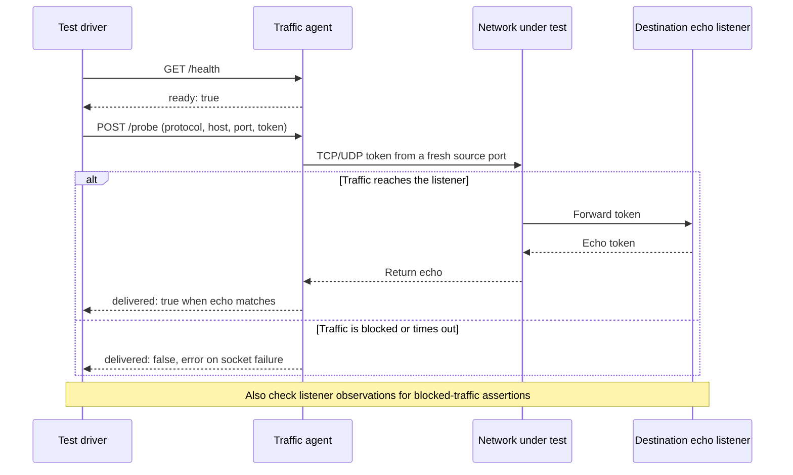

# Shared end-to-end traffic agent

`traffic_agent.py` provides a protocol-independent TCP/UDP probe service using
only Python's standard library. Use it from end-to-end forwarding tests,
reachability checks, or other test drivers that provide an echo listener.
It has no dependency on PCP, NAT-PMP, their case corpus, or Docker routing.

The test driver controls the agent over HTTP and checks delivery through the
network under test. The destination listener echoes the probe token.



Start an agent (loopback control interface by default):

```sh
python3 miniupnpd/tests/common/traffic_agent.py --port 18080
```

Command-line arguments:

- `--host ADDRESS`: HTTP listen address (default: `127.0.0.1`). Use `0.0.0.0`
  to accept control requests from an isolated test network.
- `--port PORT`: HTTP control port (default: `18080`).
- `--source4 ADDRESS`: IPv4 probe source (default: `0.0.0.0`, letting the OS
  choose the outgoing address).
- `--source6 ADDRESS`: IPv6 probe source (default: `::`, letting the OS choose
  the outgoing address).
- `--route6 PREFIX`: optional IPv6 destination prefix routed through the
  gateway. Repeat with `--gateway6` for additional prefixes; the interface is
  selected by `--source4`.
- `--gateway6 ADDRESS`: IPv6 gateway corresponding to each `--route6`; supply
  one for every route. Setup requires the Linux `ip` command and network
  administration privileges. Without these options, the agent leaves routing
  unchanged.
- `--self-test`: run HTTP and IPv4/IPv6 TCP/UDP checks on loopback without a
  gateway, then exit.
- `-h`, `--help`: show usage and exit.

The control API uses IPv4 HTTP; traffic probes
support IPv4, IPv6, and IPv4-mapped IPv6 target addresses.

`GET /health` (or `/`) returns `{"ready": true}`. `POST /probe` accepts JSON:

```json
{"protocol": "udp", "host": "127.0.0.1", "port": 12345, "token_hex": "616263", "timeout": 0.5}
```

`protocol` is `tcp` or `udp`, `host` is an IP literal, `port` is 1..65535,
and `token_hex` encodes 1..4096 bytes. The optional socket timeout defaults
to 0.5 seconds and must be greater than zero and at most 30 seconds.
The destination must echo the token. The response is `{"delivered": true}`
when the echo matches, or `{"delivered": false}` (with an `error` on socket
failure). Invalid requests return HTTP 400; unknown paths return HTTP 404.
A blocked-traffic test should also verify that its destination received nothing.

Probes bind a fresh source port from 40000..65535 so earlier conntrack state
does not hide deleted mappings. Restart the agent after exhausting that range.
This is an unauthenticated test service intended for disposable test networks.

Python callers can import `probe(spec, source4, source6)` directly, or use
`create_server(host, port, source4, source6)` to own the HTTP server lifecycle.
Pass `port=0` to allocate an available control port; read `server.server_port`.

Run the shared tests, including IPv4/IPv6 TCP/UDP echo checks:

```sh
python3 miniupnpd/tests/common/traffic_agent.py --self-test
```

The PCP/NAT-PMP Docker fixture runs `traffic_agent.py` directly. The Docker
harness supplies all fixture-specific addresses, destination prefixes and gateways.
The PCP/NAT-PMP runner also checks its own response matching, captures, and
traffic-agent integration without a daemon or Docker:

```sh
python3 miniupnpd/tests/pcp_pmp/testpcp_natpmp.py --self-test
```
