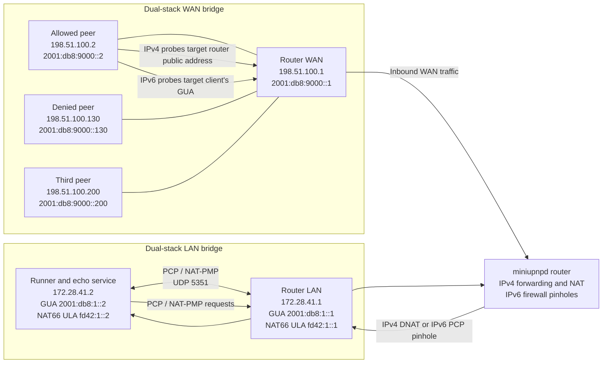

# PCP end-to-end tests

These tests verify the forwarding behavior caused by accepted PCP and NAT-PMP
requests. The YAML corpus groups scenarios into explicit sections.
They are separate from `tests/pcp_pmp`, whose corpus focuses on request and
response protocol behavior.

## Sections

- `MAP`: UDP/TCP mapping lifecycle and shared ports.
- `FILTER`: IPv4/IPv6 prefix, port, multiple-option, refresh, and clear behavior.
- `PEER`: create a mapping before traffic, adopt an existing implicit UDP/TCP
  mapping, and recreate a TCP mapping from a remembered external tuple.
  The remote echo agent reports the source tuple observed on the WAN.
- `NAT`: NAT-PMP public IPv4 address discovery and IPv6 PCP mapping with NAT66.
- `PMP`: NAT-PMP UDP/TCP mapping creation, renewal, deletion, forwarding, and
  shared-port behavior.

## Run

From the repository root, with Docker available:

```sh
./miniupnpd/tests/pcp_e2e/run-docker.sh
```

The script builds miniupnpd from the current checkout, starts a dual-stack
router with separate LAN and WAN interfaces, and starts three WAN traffic
agents with distinct IPv4 and IPv6 source addresses. A token echo listener runs
on the PCP client's LAN address. The runner sends PCP requests, checks
responses, probes IPv4 redirects or IPv6 pinholes through the router, and
removes MAP mappings using their original nonces. PEER mappings expire with
their isolated Docker fixture because RFC 6887 does not define PEER lifetime
zero as deletion. Docker fixtures and networks are removed on exit.

## Topology



The agents have a LAN interface for test control and a WAN interface for probes.
The main IPv6 test networks use documentation prefixes `2001:db8:1::/64` on
the LAN and `2001:db8:9000::/64` on the WAN. IPv4 probes target the router's public
address and require a mapping. Main IPv6 probes target the client's address
directly; PCP opens a firewall pinhole without translating that address. The
LAN interface also has an `fd42:1::/64` ULA address pair, used only by sections
with `nat66: true`.

Run selected scenarios with `--case NAME`, repeating the option as needed:

```sh
./miniupnpd/tests/pcp_e2e/run-docker.sh --case map-single-udp-only
```

NAT66 is controlled per section in `pcp-e2e-cases.yaml` with `nat66: true`.
The runner enables the IPv6 masquerade rule on entry to that section and
removes it when the section ends. Sections without the setting run with NAT66
off. The rule controls IPv6 source masquerading for outbound traffic. PCP MAP
itself still reports the address used by the client: the main cases use the
LAN GUA, while the NAT66 section uses the LAN ULA. The active postrouting rule
appears in daemon snapshots taken during the section.

PCP cases run on both IPv4 and IPv6. NAT-PMP is specified for IPv4, so its
address discovery and mapping cases run only on IPv4. Main IPv6 PCP MAP and
PEER responses are checked to preserve the client's GUA, including renewals
and cleanup. The NAT66 section instead runs its IPv6 MAP case with the LAN
client's `fd42:1::2` ULA and verifies that address is preserved in the response.

Set `PCP_E2E_KEEP=1` to retain containers and networks for debugging. Set
`PCP_E2E_ARTIFACT_DIR` to change the output root (default: `.tmp/pcp-e2e/`).
Each run stores daemon startup and final logs. Per-case artifacts are grouped
under `<run>/<family>/<section>/<case>/`; for example,
`ipv4/MAP/map-single-udp-only/`. That folder contains the packet capture
(`packet-capture.pcap`), tcpdump diagnostics, runner and daemon logs, and
before/after daemon snapshots containing the process, config, interfaces,
routes, nftables ruleset, daemon state files, and lease files. The runner
pauses after each PCP response so `daemon-expect-N.txt` captures daemon state
immediately before the expected-result assertion. The status report includes
the run artifact directory; browse its nested folders for per-case artifacts.
Override the report path with `PCP_E2E_STATUS_FILE`.

## Self-test

Check YAML structure and IPv4/IPv6 MAP and FILTER wire encoding without Docker
or a running daemon:

```sh
python3 miniupnpd/tests/pcp_e2e/run.py --self-test
```

Case definitions remain in `pcp-e2e-cases.yaml`.

## Current expected failures

The ordinary MAP lifecycle scenarios pass on the current branch except for the
IPv6 external-port conflict case. FILTER scenarios require excluded peers or
source ports to be blocked; the current daemon delivers that traffic. On
IPv4, PEER requests can adopt an existing implicit mapping, but newly created
and restored mappings currently leave the outbound source port unchanged. The
restoration case starts with a clean fixture to model loss of the previous
mapping state; it does not restart a daemon mid-case. IPv6 PEER requests return
`UNSUPP_OPCODE`, as the daemon currently handles PEER only on the NAT path. The
latest run's per-family results are in `status.md`.

Every PCP case in the MAP, FILTER, and PEER sections has IPv4 and IPv6 coverage.
NAT-PMP cases are IPv4-only because NAT-PMP does not define IPv6 operation.
FILTER cases
exercise exact peers, remote ports, prefixes, multiple options, refresh
updates, and prefix-zero clearing. Prefixes are chosen per address family to
distinguish the allowed and denied traffic agents. The runner encodes FILTER
fields in RFC order: reserved byte, prefix length, remote peer port, and
address. RFC 6887 defines prefix zero as removing all prior filters and a
refresh with additional FILTER options as adding those peers to the set.
