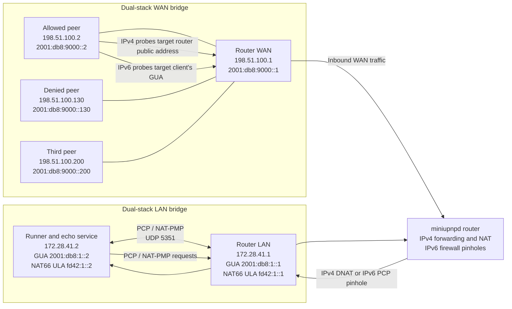

# PCP end-to-end tests

These tests verify the forwarding behavior caused by accepted PCP and NAT-PMP
requests. The YAML corpus groups scenarios into explicit sections.
They are separate from `tests/pcp_wire`, whose corpus focuses on request and
response protocol behavior.

## Sections

- `MAP`: UDP/TCP mapping lifecycle and shared ports.
- `FILTER`: IPv4/IPv6 prefix, port, multiple-option, refresh, clear, and
  1100-octet message-boundary behavior.
- `PEER`: create a mapping before traffic, adopt an existing implicit UDP/TCP
  mapping, recreate a TCP mapping from a remembered external tuple, and process
  optional options at the 1100-octet message limit.
  The remote echo agent reports the source tuple observed on the WAN.
- `NAT`: NAT-PMP public IPv4 address discovery and IPv6 PCP mapping with NAT66.
- `PMP`: NAT-PMP UDP/TCP mapping creation, renewal, deletion, forwarding, and
  shared-port behavior.

## Run

From the repository root, with Docker available:

```sh
./miniupnpd/tests/pcp_e2e/run-docker.sh
```

The script builds miniupnpd from the current checkout, starts a dual-stack
router with separate LAN and WAN interfaces, and starts three WAN traffic
agents with distinct IPv4 and IPv6 source addresses. A token echo listener runs
on the PCP client's LAN address. The runner sends PCP requests, checks
responses, probes IPv4 redirects or IPv6 pinholes through the router, and
removes MAP and PEER mappings using their original nonces (lifetime 0, RFC 6887
section 15). Docker fixtures and networks are removed on exit. The fixture is
`../common/compose.yaml`, so Docker Compose is required.

## Run with a Debian router and iptables

`run-debian-iptables.sh` runs the same corpus on a Debian VM running miniupnpd with iptables. It is `run-freebsd.sh` with another router, so it has the same options, and the LAN client and the WAN agents are Docker containers on the host, with no Docker in the VM.

The VM has its own kernel. miniupnpd uses libiptc, so the router uses the legacy iptables tables, and the host does not need their modules. The result of each case fills the `debian-iptables` column of `status.md`.

## Run with a FreeBSD router

`run-freebsd.sh` runs the same corpus (`--case NAME` works too) with a FreeBSD
QEMU VM as the router, running miniupnpd with pf, and Linux Docker containers
for the LAN client and the three WAN agents:

```sh
./miniupnpd/tests/pcp_e2e/run-freebsd.sh
```

It needs no root. The VM has three NICs: `vtnet0` (QEMU user networking, SSH
only), `vtnet1` (LAN) and `vtnet2` (WAN). The last two are QEMU `stream`
netdevs connected to a relay container (`freebsd/qemu_docker_l2_relay.py`) that sits on both
Docker bridges and copies raw Ethernet frames, so the VM appears as
`172.28.41.1` / `198.51.100.1` (and the matching IPv6 addresses) just as the
Linux router does in `run-docker.sh`. The relay completes the TCP/UDP/ICMPv6
checksums that Linux veth leaves to hardware offload, and hides its own QEMU
control connection from the VM. It handles ordinary test-sized frames, not
GSO super-packets.

The pf ruleset blocks inbound WAN traffic except Neighbor Discovery and the
miniupnpd anchor, passes LAN traffic with state, and NATs IPv4 (and IPv6 in
`nat66` sections). The VM steps are those of `../common/vm_lib.sh`, and the VM image cache is
shared with the VM of `pcp_wire` and `daemon_options` (`../common/freebsd_vm.sh`). The release is
`--freebsd-version` or `PCP_TEST_FREEBSD_VERSION`, by default the newest with a cloud image. The result of each case fills the `freebsd`
column of `status.md` (the Docker run fills `linux`; override the report with
`E2E_STATUS_FILE`), and the artifacts go to `.tmp/pcp-e2e/freebsd-<run>-slot<N>/`, in the
same per-case layout as the Docker run, with pcaps taken on `vtnet1`/`vtnet2`
and pf rule/state snapshots instead of nftables ones. PCP PEER is only built
with the netfilter backend, so the PEER cases fail with `UNSUPP_OPCODE` here,
and a first run showed the MAP FILTER "expected blocked" cases being delivered
on pf. Those are daemon results to triage, not harness faults.

In CI, the `end2end-freebsd` job of `.github/workflows/regression-testing.yml` runs this driver on
a GitHub Ubuntu runner (KVM, FreeBSD 14.5 and 15.1; the downloaded and prepared images are
cached), with master's daemon and the pull request's, at the same time as `end2end-linux`, which
does the same with `run-docker.sh`. Both run `../common/tools/compare_daemon_branches.py
--suite end2end`; [`compare.py`](compare.py) tells it how to run this suite and read its results.

### Keeping the VM between runs

A normal run boots a fresh VM, builds miniupnpd and removes everything afterwards. To
iterate on the daemon or the tests, keep the fixture (the VM, the Docker networks, the
relay and peers, and the build tree in the VM) and copy in only what changed:

```sh
./miniupnpd/tests/pcp_e2e/run-freebsd.sh up                    # once: boot, build, start
./miniupnpd/tests/pcp_e2e/run-freebsd.sh --reuse --case NAME   # sync, rebuild what changed, run
./miniupnpd/tests/pcp_e2e/run-freebsd.sh --reuse --from cases  # tree unchanged: only the cases
./miniupnpd/tests/pcp_e2e/run-freebsd.sh status | ssh [command] | down
```

`--reuse` checks that the VM is the one it started (process, start time and a token in the
VM), that the relay and peers run, and falls back to a fresh start of what is missing.
`--keep-vm` starts a fresh fixture and leaves it up. `--from sync|build|daemon|cases|restart`
starts at that stage (default with `--reuse`: `sync`), `--rebuild` configures and builds
everything again, `--no-build` skips the copy and the build, and `--no-restart` /
`--only-restart` skip or select the restart check.

The daemon is stopped and started from a clean state on every run (anchor, pf states,
NAT66, lease files and logs), so cases do not see what an earlier run left. The fixture is
in `$PCP_TEST_FREEBSD_CACHE/e2e-vm/$PCP_E2E_VM_NAME` (default name `slotN`) and uses SSH
port `PCP_E2E_FREEBSD_SSH_PORT` (default 2230+N), so it does not clash with the VM of
`../common/freebsd_vm.sh` from 2401. One run at a time uses a fixture (`flock`).

### Running FreeBSD fixtures side by side

Docker refuses two networks whose subnets overlap, so every fixture has an address plan of
its own: a *slot* (`e2e_address_plan` in `../common/e2e_lib.sh`). There are 128 slots and
the slot N is the third octet of both IPv4 subnets. `run-freebsd.sh --slot N` (or
`PCP_E2E_SLOT=N`) picks a slot of 1-128 (default the first free one, slot 1 for a kept
fixture), which also gives the fixture its
name, SSH port and Docker names. `run-docker.sh` also takes the first free slot by itself, or
the one in `PCP_E2E_SLOT`, and names its networks `pcp-e2e-lan-N` and `pcp-e2e-wan-N`. All
runs share one image with no source in it, `miniupnpd-test-tools:HASH`, the hash being of
`common/docker`. The daemon is compiled in that image from a copy of the tree into
`.tmp/tests/daemon/KEY`, the key being a hash of the source, the image and the configure flags, and
each router mounts that directory read-only: the same source is compiled once, and a run from
another tree cannot get this daemon. Every
Docker and QEMU driver reserves through `reserve_slot`: `flock` on
`/tmp/pcp-e2e-slots/slot-N.lock` (`PCP_E2E_LOCK_DIR`) until it exits, skipping a slot whose WAN
subnet still exists:

| Slot | LAN | WAN | SSH port | Fixture |
|---|---|---|---|---|
| N | 172.28.N.0/24, 2001:db8:1:N::/64 | 6.18.N.0/24, 2001:db8:9000:N::/64 | 2230+N (FreeBSD) | `slotN` (FreeBSD) |

The WAN uses `6.18.0.0/16`, public space on purpose: the daemon sees a normal WAN address. A run hides
those addresses from the host, and nothing routes them to the internet. The hosts
keep their last octet / interface ID in every slot (router `.1` / `::1`, client `.2` / `::2`,
peers `.2`, `.130`, `.200` on the WAN). The NAT66 ULA `fd42:1::/64` exists only behind the
router and is the same in every slot.

```sh
./miniupnpd/tests/pcp_e2e/run-freebsd.sh --slot 2 &          # two fresh runs at once
./miniupnpd/tests/pcp_e2e/run-freebsd.sh --slot 3 &
./miniupnpd/tests/pcp_e2e/run-freebsd.sh --slot 4 up         # a kept fixture in slot 4
./miniupnpd/tests/pcp_e2e/run-freebsd.sh --slot 4 --reuse --case NAME
```

A kept fixture remembers its slot and refuses another one. Runs of all slots share the
cached FreeBSD images (the first one prepares them, `flock`) and update the same `freebsd`
column of `status.md` one at a time, so the last run of a case wins. Cases name the addresses
that depend on the plan (`client`, `router-wan`, `unowned-wan`, the peers) and the driver
passes them with `--peer-address NAME=ADDRESS`.

## Topology

The addresses below are an example layout; every slot has the same hosts in its own subnets.



The agents have a LAN interface for test control and a WAN interface for probes.
The main IPv6 test networks use documentation prefixes `2001:db8:1::/64` on
the LAN and `2001:db8:9000::/64` on the WAN. IPv4 probes target the router's public
address and require a mapping. Main IPv6 probes target the client's address
directly; PCP opens a firewall pinhole without translating that address. The
LAN interface also has an `fd42:1::/64` ULA address pair, used only by sections
with `nat66: true`.

Run selected scenarios with `--case NAME`, repeating the option as needed:

```sh
./miniupnpd/tests/pcp_e2e/run-docker.sh --case map-single-udp-only
```

NAT66 is controlled per section in `pcp-e2e-cases.yaml` with `nat66: true`.
The runner enables the IPv6 masquerade rule on entry to that section and
removes it when the section ends. Sections without the setting run with NAT66
off. The rule controls IPv6 source masquerading for outbound traffic. PCP MAP
itself still reports the address used by the client: the main cases use the
LAN GUA, while the NAT66 section uses the LAN ULA. The active postrouting rule
appears in daemon snapshots taken during the section.

PCP cases run on both IPv4 and IPv6. NAT-PMP is specified for IPv4, so its
address discovery and mapping cases run only on IPv4. Main IPv6 PCP MAP and
PEER responses are checked to preserve the client's GUA, including renewals
and cleanup. The NAT66 section instead runs its IPv6 MAP case with the LAN
client's `fd42:1::2` ULA and verifies that address is preserved in the response.

Set `PCP_E2E_KEEP=1` to retain containers and networks for debugging. Set
`PCP_E2E_ARTIFACT_DIR` to change the output root (default: `.tmp/pcp-e2e/`).
Each run stores daemon startup and final logs. Per-case artifacts are grouped
under `<run>/<family>/<section>/<case>/`; for example,
`ipv4/MAP/map-single-udp-only/`. That folder contains the packet capture
(`packet-capture.pcap`), tcpdump diagnostics, runner and daemon logs, and
before/after daemon snapshots containing the process, config, interfaces,
routes, nftables ruleset, daemon state files, and lease files. The runner
pauses after each PCP response so `daemon-expect-N.txt` captures daemon state
immediately before the expected-result assertion. The status report includes
the run artifact directory; browse its nested folders for per-case artifacts.
Override the report path with `E2E_STATUS_FILE`.

The report has the same structure as the one of `pcp_wire` (both are written by
`common/lib_test.py`): one column per platform, a table of cases per section
(case, protocol, family, a status per platform, result / note), and the counts per
platform. A run updates only its own platform's column and the address families it
ran. The raw results are in `.tmp/tests/pcp_e2e/status-data.json` of the repository
(`E2E_STATUS_DATA_FILE` to change that), not in the test directory. Writing the
report needs `python3` with PyYAML on the host.

## Self-test

Check YAML structure and IPv4/IPv6 MAP and FILTER wire encoding without Docker
or a running daemon:

```sh
python3 miniupnpd/tests/pcp_e2e/run_pcp_e2e_cases.py --self-test
```

Case definitions remain in `pcp-e2e-cases.yaml`.

Requests are written as named packets and expanded by `../common/pcp_corpus_expander.py`:

```yaml
request:
  pcp: MAP                       # or PEER (with remote_peer / remote_peer_port)
  lifetime: 120
  protocol: udp
  internal_port: 41006
  suggested_external_port: 41006
  options:                       # FILTERs, then PREFER_FAILURE, then UNKNOWN_OPTIONAL
    - FILTER: allowed-peer       # exact address (/32 or /128), any port
    - FILTER: {remote_peer: denied-peer, remote_port: 42000, prefix_length: 24}
    - PREFER_FAILURE
request: {natpmp: UDP, private_port: 41100, public_port: 41100, lifetime: 120}
```

`natpmp:` takes `UDP`, `TCP` or `PUBLIC_ADDRESS`. A top-level `defs.packets.<name>`
with `use: <name>` in a request reuses a packet; the old flat keys (`opcode`,
`filter`, `prefer_failure`, ...) are still accepted.
